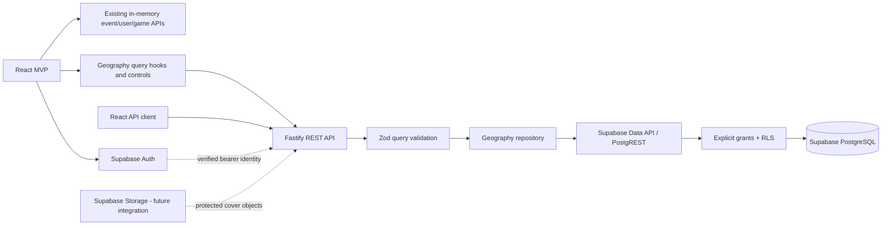

# RollCall backend architecture

Discussion routes/repository live in modules/events/event-discussion.ts and call checked RPCs with the unprivileged caller JWT. Migration 25 uses a restricted executor, existing active-account/current-permission helpers, shared parent event locks, committed attempt outcomes and atomic immutable moderation audits. No raw grants, private-event admin override or Storage changes are introduced. See [security/contracts](event-discussions.md).

Profile game-set saves use `PUT /api/me/game-experience` with complete desired/expected
sets and the caller-RLS `replace_my_game_experience` RPC. Migration 21 serializes batch,
legacy and direct authenticated writes, rejecting stale sets with 409. Runtime stays
unprivileged; no deletion worker or deletion endpoint is enabled. See [profiles](profiles.md).

## Profile/event UX security follow-up

The discovery UX extension adds a single authenticated POST batch self-status endpoint,
with Zod/SQL bounds and response identity/allowlist validation. Missing/private-inaccessible
rows are omitted; public discovery remains separate and never viewer-scoped. No full-detail
N+1 reads or raw table grants are introduced. Existing attendance APIs supply acknowledged
counts/state for UI cache updates; failed/ambiguous writes revalidate server truth.

Forward migrations 22–23 add a narrow owner-only case-correction executor and a separate
age executor. Only the latter can read owner DOB through RLS; event/invitation executors
receive EXECUTE on the closed age helper, never DOB-column access. Existing checked admission
functions retain signatures, ACLs, owners and event locks. Invitation age failures return
internal statuses so rate-limit attempts commit before HTTP 403 is produced. New event rule
validation runs in Zod and an additive trigger; safe summaries gain stored age/recommendation.
No service role, Auth metadata DOB, public private-age projection or new runtime secret is
introduced. See [contracts and tested boundaries](profile-event-ux.md).

## Milestone 4D cover boundary

Registration preparation now lives in the Auth module at
`POST /api/auth/registration-intent`. It sends strict username/email/DOB input through
an unprivileged RPC client plus the existing backend-only operation capability; the
browser sends no password to Fastify and no DOB to Auth metadata. Transactional private
tickets bind username, email hash and DOB to Auth INSERT, with persistent bounded abuse
counters. No service role, new operator endpoint or proxy trust is introduced.
See [registration and startup](registration.md) for migration 17 and runtime requirements.

Forward migration 18 preserves validated username spelling while retaining lower-based
uniqueness for profiles and adding it for intents. Profile RPC/API DTOs add only optional
nullable public `username`; grants/RLS, Auth/DOB triggers and suspension checks stay intact.
Deploy database, backend, then frontend per [auth rollout](auth-experience.md).

Real covers now use a private Supabase bucket and backend-mediated multipart endpoints.
Sharp validates bounded image content, strips metadata and produces canonical WebP. A
server-only operation capability complements the existing verified caller JWT; SQL/RLS
require both for exact reserved-path writes. Runtime uses no service-role key or privileged
database connection. Operation-aware Storage policies deny listing, direct writes and
arbitrary signing. Read/sign authorization follows current event visibility/membership.

Checked cover RPCs maintain a protected application manifest and the existing event
reference. Replacement commits a new association before retiring the old file; event
deletion queues cleanup. Supported Storage removals, bounded retries and tombstones handle
partial failure across the database/Storage boundary. Responses contain stable cover
metadata; short-lived authorized URLs come from a separate no-store endpoint and never
enter event list caches. See [cover architecture/setup](event-covers.md) and
[executed verification](event-cover-verification.md). Earlier milestone descriptions below
retain their historical delivery boundaries.

## Current delivery boundary

Workshop 3 is the completed React mock MVP. Backend Milestone 1 is a separate Node.js/
TypeScript workspace package with Fastify, Zod, Supabase PostgreSQL migrations and a
read-only geography API. Milestone 2A adds local GeoNames import tools, aliases and improved
database search. Milestone 2B connects React geography controls to those read endpoints.
Milestone 3A adds real Supabase Auth and verified Fastify identity. Milestone 3B adds real
UUID profiles, private age and per-game experience with a read-only database game catalog.
Milestone 4A adds persistent backend event discovery/details and host-only CRUD. Milestone
4B adds transactional persistent attendance and participant-aware details. React real event
reads and actions are connected in 4C-1/4C-2 through separate UUID DTOs, validated mutation
clients and viewer-specific queries. Numeric catalogs/events and custom browser covers remain
explicit development demos, separate from real UUID accounts. See
[frontend action verification](event-actions-verification.md).

The intended application path is React → Fastify → Supabase PostgreSQL. The current
database transport is Supabase's Data API, not a direct privileged SQL connection.
This keeps the application role subject to grants/RLS and avoids adding a database
password or service-role key to the API process.

## Package responsibilities

`backend/src/app.ts` assembles the Fastify application without opening a socket so
tests can use injection. `server.ts` loads validated environment and starts/stops the
server. `config/` owns environment validation, `db/` owns server-only Supabase setup,
`modules/geography/` owns its routes, query/response validation and repository, and
`shared/` owns common error handling. `backend/scripts/geography/` is a separate local
maintenance importer; it is not imported by the API or bundled into the application build.
`modules/auth/` owns token verification, request-local identity and the reusable guard
used by `/api/me` and private profile operations. `modules/profiles/` owns profile/catalog
routes, strict validation and user-scoped data access. `modules/events/` owns event routes,
Zod payload/DTO schemas, cursor encoding, curated tags and the checked-RPC repository.
Only implemented modules are created.

The backend never imports frontend feature internals. SQL database rows use snake_case;
the REST boundary uses explicit camelCase DTOs and keeps errors compatible with the
existing `{ code, message, fields }` convention. A later integration must adapt API DTOs
inside feature API layers rather than rewriting component data access.

## Data access and least privilege

The runtime API uses a server-only Supabase client with a publishable key (or the local
legacy anon key). It has no user session, browser storage, automatic refresh or privileged
role. Public reads include enabled geography and public-safe profiles/games/experience.
City search calls the explicitly
granted, security-invoker `public.search_cities` function, which remains subject to
the caller's table grants and RLS. Canonical and source alternate names are normalized in
PostgreSQL. Exact matches rank ahead of prefixes, then substrings for queries with at least
three normalized characters; shorter queries use only prefixes. Both name catalogs have
prefix and trigram indexes. Result limits stay bounded and city IDs are deduplicated.
Empty input favors population, then normalized name and ID. The reset seed has no population
metadata; the explicit import supplies source population values.

All application tables have RLS enabled. Migrations revoke implicit/default access and
grant only the current geography/profile/catalog operations and checked event RPCs. Profile writes use owner RLS
and mutable-column privileges; private birth year is owner-only. Events, protected event
addresses and role records remain unavailable as raw tables to client roles. Event APIs use
the bounded functions described below; broad event table grants are unnecessary.

## Geographic import maintenance boundary

Milestone 2A's importer connects directly to local PostgreSQL using a separately configured
`GEOGRAPHY_DATABASE_URL`, rejecting non-loopback targets. This is an offline maintenance
privilege, not a service-role HTTP client or an authorization shortcut for API requests.
The API neither reads that variable nor invokes the importer. Keep the connection string
in ignored local configuration and never print it in reports.

Only the four GeoNames country extracts are used. Input parsing/validation, SHA-256 reports,
per-country transactions and an advisory import lock make runs reviewable and safe to repeat.
Parameterized staging and set-based merges avoid constructing SQL from place names. Source
IDs identify existing records; internal city IDs and application foreign keys remain stable.
Known development seeds can be enriched only with an unambiguous source match. No absent
source record triggers a city deletion, and source aliases are additive.

Apply the new versioned migration without resetting existing data. The development reset
still provides only 13 sample cities; imports are never an automatic side effect of startup,
build, or migration. [Geographic import](geographic-import.md) documents exact inclusion
rules, provenance, reruns, limitations and query verification. Milestone 2B consumes bounded
suggestions rather than shipping the geographic dataset to the browser. See
[frontend location integration](location-ui.md).

The public Supabase URL and unprivileged key identify a project; they are not an
authorization mechanism. A caller could reach any directly granted Data API route.
Therefore Fastify validation is supplemented by SQL constraints, function argument bounds,
explicit grants and RLS. API-only authorization cannot be assumed while tables/functions
are also reachable through the Data API.

## Milestone 3A authenticated access

The browser users feature owns a Supabase Auth client for email/password registration,
login/logout, confirmation and recovery. Supported PKCE/session persistence/refresh replace
custom token handling. It uses only public configuration and does not access application
tables directly. Real UUID accounts never become numeric demo event actors.

Fastify verifies bearer tokens using Supabase `getClaims`: asymmetric keys use the Auth
JWKS; symmetric keys use Auth-server verification. Additional checks enforce configured
issuer, authenticated audience, expiration and UUID subject. The reusable guard attaches
safe request-local identity. `GET /api/me` returns only `{ id, email }`, with `no-store`;
missing, malformed, invalid and expired tokens return 401 `UNAUTHENTICATED`. Geography
does not use this guard and remains public. Never trust a submitted user ID, demo actor,
arbitrary decoded JWT, client-supplied role or editable `user_metadata` for authorization.

The minimal registration trigger initializes a fixed-placeholder profile without creating
roles. Milestone 3B adds focused profile permissions without changing that initializer.
Logout revokes refresh capability for the session; an issued access JWT may remain valid
until expiry. This is standard token behavior, not instantaneous server-side logout
revocation. See [authentication](authentication.md) for setup and verification boundaries.

Profile operations now use an isolated per-request Supabase client carrying
the verified user's bearer token. Do not mutate a shared client's session or install a global
current user. Explicit grants plus operation-specific RLS must then enforce the same
identity and ownership rules. A carefully scoped transactional database function may be
used for operations such as joining, with its caller/authorization checked inside the
transaction. Add those grants/functions only with the endpoint and allow/deny tests.

## Milestone 3B profile boundary

The auth guard verifies each protected request before its exact bearer token is passed to
a newly constructed unprivileged Supabase client. It never sets a shared current user.
Profile/experience RPCs derive ownership from `auth.uid()`, not JSON actor IDs. A strict
nonempty profile PATCH is applied atomically with optional private birth year under one
PostgreSQL transaction and caller RLS. Public DTO construction is explicit and contains
no email, age/declaration timestamp, role or privileged metadata.

The private schema remains unexposed by PostgREST. Authenticated schema usage and focused
owner-only private-profile grants support SECURITY INVOKER functions, without opening
roles or event locations. Column grants deny UUID/creation/update timestamp changes.
Country-enabled checks and the existing city/country FK also protect direct Data API
writes. Unique user/game keys and owner policies protect per-game experience. Catalog
games are public/read-only. Browser components use Fastify; they do not access application
tables directly. See [profiles](profiles.md) for contracts and executed checks.

There is no general service-role repository in Milestone 1. If a future maintenance or
moderation operation requires privileged access, isolate it behind a separately reviewed
server-only path with explicit authorization and minimal data returned. Do not turn off
RLS or route ordinary requests through a bypass client.

## Milestone 4A event boundary

Event discovery always constructs an anonymous repository. Optional authenticated details
verify a supplied bearer before using a fresh token-scoped client; writes require the same
guard. No host/actor ID is accepted from payloads. Zod projects public versus host DTOs and
rejects malformed upstream responses. Discovery returns bounded chronological keyset pages,
with original PostgreSQL microsecond precision retained in cursors. No raw rows or protected
address keys appear in public JSON. Private and missing records share the same HTTP 404.

Public SECURITY INVOKER wrappers call hardened private entry points owned by
`rollcall_events_executor`, a NOLOGIN/NOBYPASSRLS role with limited columns and explicit RLS.
API roles are not members, cannot SET ROLE, and receive no event/location/attendance table
grants. Only checked discovery/details are executable anonymously; writes require authenticated
execution and derive the subject internally. The private argument-free `event_api_actor()`
is owned by the migration role solely to call `auth.uid()` across Supabase's separately owned
Auth schema; it reads no tables and is executable only by the executor. All paths are empty,
objects qualified and ACLs explicit. Private schema USAGE permits function naming, not table
access; PostgREST still does not expose that schema.

At the original 4A boundary, RLS and explicit host checks restrict private details, writes and exact addresses to the host,
including when a sharing flag, existing participation or an admin role exists. Create/update
validate SQL inputs and final relationships/schedules/tags inside one transaction. Updates
lock the event before checking capacity against attendance. Deferred location invariants are
flushed while the authorized executor context is active. Hard delete cascades locations and
memberships, including past/cancelled records, while referenced catalog/profile data remains.
See [event contracts](events-api.md) and [executed checks](events-api-verification.md).

Milestone 4B extends participant reads/attendance below. React adapters (4C), Storage (4D)
and private-code/role access (5) remain deferred.

## Milestone 4B attendance boundary

POST/DELETE `/api/events/:eventId/attendees/me` use the existing verified UUID guard and
fresh bearer-scoped unprivileged client. Payload/query allowlists never accept a participant
ID. Checked join/leave RPCs derive the subject internally, lock the event row, recheck current
private membership and actual start time, and mutate the existing composite-key membership
table. No client read-count-then-insert race is possible; capacity edits/deletion use the same
parent lock. No-op joins/leaves preserve timestamps while retaining access/state/host checks.
Private outsiders stay concealed; existing private participants can leave, losing detail access.

Owner membership policies avoid event-table references and RLS cycles. Event/location reads
allow the verified host/current member; content writes remain host-only. A lock-only UPDATE
policy with false WITH CHECK allows SELECT FOR UPDATE but no nonhost content write. The
separate `rollcall_attendance_counter` non-login/non-bypass role owns existing counter and
location-invariant triggers, with counter-column update and location-ID read privileges only.
It never reads address text or owns tables. Trigger functions are hardened, not client-callable;
raw membership/event/location tables remain closed to API roles. No privileged client is used.

Details include viewer `{userId,isHost,hasJoined}`; the repository verifies the viewer subject
against its independently verified caller and projects explicit public/host/participant DTOs.
Only hosts/current participants receive address text. Mutation summaries contain event ID,
joined state and capacity/count/slots, without addresses or private profile fields. No-store
and Authorization variance apply. Participant caches in 4C must be isolated by real UUID and
cleared/refetched on account changes or attendance mutations. No age/experience gating,
participant lists, private admission or admin override is added. See
[event contracts](events-api.md) and [attendance verification](attendance-verification.md).

## Sensitive data and authorization design

| Resource                        | Current access                      | Intended authorization                                                                             |
| ------------------------------- | ----------------------------------- | -------------------------------------------------------------------------------------------------- |
| Enabled countries/cities        | Anonymous/authenticated read        | Public catalog and bounded search                                                                  |
| Public-safe profiles/games      | Public reads; owner profile updates | Public-safe reads; self-only profile edits                                                         |
| Private profile age information | Owner-only RLS/invoker RPC          | Self-only read/write; no public DTO field                                                          |
| Per-game experience             | Public reads; owner writes          | Self-declared user-owned values; no attendance eligibility inference                               |
| Public events                   | Checked discovery/detail RPCs       | No address in public DTOs; host-only writes                                                        |
| Unlisted events                 | Checked direct detail RPC           | Hidden from discovery; link never grants address access                                            |
| Private events                  | Verified host/current member detail | No outsider admission; role overrides and invitation codes remain deferred                        |
| Exact event locations           | Verified host/current member DTO    | No address to anonymous/nonmembers; sharing flag grants no access                                  |
| Account roles                   | No client grants                    | Server-enforced authorization; only authorized superadmins manage admins                           |
| Invitation secrets              | No table/workflow yet               | Separate server-managed encrypted storage and hash verification                                    |

Age guidance uses an optional self-declared birth year, without collecting a birth date.
It is approximate and unverified, not a proof of age. Event `minimum_age` remains guidance.
Per-game `beginner`, `intermediate`, or `veteran` experience is also self-declared and does
not replace each event's `all-levels`, `beginner`, or `experienced` expectation.

Event capacity excludes the host. The attendance table's unique key prevents duplicate
seats and database triggers serialize capacity changes on the event row. Join/leave
API functions atomically authorize the actor, check future/scheduled availability, apply
membership changes and return a safe attendance summary. Milestone 4B implements these
operations with genuine lock-contention tests; details expose separately authorized viewer
state/address access. Idempotent repeats preserve the scoped existing contract.

## Private room codes: later milestone

Private events remain inaccessible before authorization. A future code-entry workflow
must validate a code and join in one secure server transaction, with capacity/state and
actor checks. Rate-limit by actor and network source, return neutral failure messages,
and avoid placing codes in URLs or logs.

Generate high-entropy codes with a cryptographically secure generator. Store a keyed
hash for validation and, only because hosts/admins need retrieval, authenticated
encryption ciphertext in a separate non-exposed table. Keep encryption/HMAC keys on the
server, version keys, and audit access without logging code contents. Encrypting a secret
does not make it suitable for a public event column.

The future table should associate an event, encrypted code, verification digest, key
version, creation time, rotation/revocation time and optional expiry. Rotation atomically
invalidates the previous digest; revocation immediately blocks joining. Existing members
must never receive a code through event or attendee responses. Only the host or an
authorized admin/superadmin may retrieve/rotate/revoke it. No secrets table, code API,
rate limiter or invitation interface is claimed as implemented now.

## Runtime and failure behavior

Configuration is validated before startup. Supabase credentials/configuration remain in
`backend/.env`; browser Auth uses only the public values in `frontend/.env`. The API returns uniform validation,
not-found, upstream-unavailable and unexpected-error responses without leaking database
messages or credentials. Supabase requests are time-bounded. Logs must omit authorization
headers, cookies, keys and private payloads.

`GET /health` is process liveness, not a database readiness probe. Geography calls fail
with a controlled 503 when the configured database/Data API cannot be reached or returns
invalid data. No mock fallback silently substitutes fixture results. A valid country
with no matching places returns `[]` rather than an error.

The API defaults to loopback. Production CORS, rate limiting,
deployment/TLS/proxy settings, operational monitoring and hosted project setup are later
release requirements. This milestone does not deploy or modify a remote Supabase project.

## Verification boundaries

- Fastify injection tests verify routing, strict input validation, DTOs and sanitized errors.
- Repository tests verify Data API queries against a controlled transport.
- Local integration tests exercise a migrated/seeded local Supabase database when available.
- SQL tests verify grants, RLS, constraints and search at the database layer.
- Import tests verify source filtering/validation and safe reruns; actual local imports and
  query plans verify behavior on the loaded dataset. Small parser fixtures or index existence
  are not evidence of geographic completeness or production performance.
- A successful TypeScript build is not proof that migrations ran. Record unavailable local
  Docker/Supabase checks explicitly in the delivery report.

## Official references

- [Fastify getting started](https://fastify.dev/docs/latest/Guides/Getting-Started/)
- [Fastify testing and injection](https://fastify.dev/docs/latest/Guides/Testing/)
- [Zod parsing and validation](https://zod.dev/basics)
- [Supabase JavaScript initialization](https://supabase.com/docs/reference/javascript/initializing)
- [Supabase API security, grants and RLS](https://supabase.com/docs/guides/api/securing-your-api)
- [Supabase row level security](https://supabase.com/docs/guides/database/postgres/row-level-security)
- [Supabase local CLI development](https://supabase.com/docs/guides/local-development/cli/getting-started)

## Milestone 5A

5A uses authenticated encryption, domain-separated keyed verification and backend-capability-protected RPCs. Failed attempts commit durable account limits; process-local IP limits supplement them. Event locks and existing attendance triggers provide atomic admission. See [architecture and verification](private-invitations.md).

## Milestone 5B-1

Administration owns current trusted permissions, a reusable capability guard and bounded superadmin role/audit APIs. Requests use the existing verified bearer-scoped unprivileged Data API client. RPCs independently authorize callers, rechecking after the role-mutation transaction lock. Role updates/audits are atomic; existing feature authorization is unchanged. Local bootstrap uses a separate explicitly confirmed maintenance connection, never runtime credentials. See [administration](administration.md).

## Milestone 5B-2A

Moderation owns strict report/review/decision routes and checked RPCs, using existing verified caller-scoped unprivileged clients and capability guards. Database access independently enforces current admin/superadmin roles, legitimate reporting access, durable throttles and atomic decisions. No blanket admin event editing or private-content retrieval is added. Parent event locks coordinate attendance, moderation and FK deletion; role-change locks serialize demotion with moderation. See [contracts and tests](event-moderation.md).

## Milestone 5B-2B

The shared Auth guard checks fresh account status after verifying credentials, except explicitly allowed identity/self-status paths. PT403/ACCOUNT_SUSPENDED is preserved as a safe 403 application error even for races after the initial check. SQL wrappers, actor resolvers, raw profile-write policies and Storage policies independently enforce the current state. All future protected RPCs must guard before domain locks. See [lock order, failure handling and limits](account-suspensions.md).

## Hosted staging preparation (6A-1)

`backend/scripts/staging` is a separate operator entry point; it is never imported by Fastify.
Offline inventory/catalog/geography previews do not connect. Applying requires complete
5B-2B source, independently pinned staging reference/origin/database host, verified TLS,
explicit write enablement and action-specific confirmation. A shared session lock serializes
operator work; import transactions retain their existing country-level lock/bounds.
Privileged maintenance credentials are isolated in ignored `.staging/operator.env`; the
runtime remains publishable-key/caller-token only. Raw generated staging roots are isolated
from ordinary local keys. [Rollout and pending hosted checks](hosted-supabase-staging.md).

## Prepared hosted application topology (6B-1)

Vercel serves only Vite static output and rewrites browser `/api/*` to the reviewed Render
HTTPS origin, preserving `/api`. Render runs the compiled API with platform environment
variables; no local env file, database password or maintenance tools are loaded. Supabase
Auth remains direct from the browser; Fastify uses an unprivileged key plus verified caller
tokens. Existing live suspension/RLS/Storage checks remain authoritative. No CORS or forwarded-IP
trust expansion is introduced. Render maintenance and Vercel Preview protection gate access
while 6A-2 acceptance remains pending. [Setup and limits](application-hosting.md).
