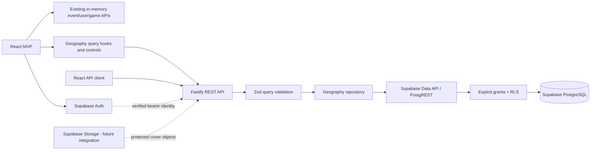

# RollCall backend architecture

## Current delivery boundary

Workshop 3 is the completed React mock MVP. Backend Milestone 1 is a separate Node.js/
TypeScript workspace package with Fastify, Zod, Supabase PostgreSQL migrations and a
read-only geography API. Milestone 2A adds local GeoNames import tools, aliases and improved
database search. Milestone 2B connects React geography controls to those read endpoints.
Milestone 3A adds real Supabase Auth and verified Fastify identity. Milestone 3B adds real
UUID profiles, private age and per-game experience with a read-only database game catalog.
Numeric event/demo catalog IDs, images, create/edit and attendance remain mocked. Demo selection is explicitly
enabled only during Vite development and is separate from real UUID accounts.

The intended application path is React → Fastify → Supabase PostgreSQL. The current
database transport is Supabase's Data API, not a direct privileged SQL connection.
This keeps the application role subject to grants/RLS and avoids adding a database
password or service-role key to the API process.

## Package responsibilities

`backend/src/app.ts` assembles the Fastify application without opening a socket so
tests can use injection. `server.ts` loads validated environment and starts/stops the
server. `config/` owns environment validation, `db/` owns server-only Supabase setup,
`modules/geography/` owns its routes, query/response validation and repository, and
`shared/` owns common error handling. `backend/scripts/geography/` is a separate local
maintenance importer; it is not imported by the API or bundled into the application build.
`modules/auth/` owns token verification, request-local identity and the reusable guard
used by `/api/me` and private profile operations. `modules/profiles/` owns profile/catalog
routes, strict validation and user-scoped data access. Only implemented modules are created.

The backend never imports frontend feature internals. SQL database rows use snake_case;
the REST boundary uses explicit camelCase DTOs and keeps errors compatible with the
existing `{ code, message, fields }` convention. A later integration must adapt API DTOs
inside feature API layers rather than rewriting component data access.

## Data access and least privilege

The runtime API uses a server-only Supabase client with a publishable key (or the local
legacy anon key). It has no user session, browser storage, automatic refresh or privileged
role. Public reads include enabled geography and public-safe profiles/games/experience.
City search calls the explicitly
granted, security-invoker `public.search_cities` function, which remains subject to
the caller's table grants and RLS. Canonical and source alternate names are normalized in
PostgreSQL. Exact matches rank ahead of prefixes, then substrings for queries with at least
three normalized characters; shorter queries use only prefixes. Both name catalogs have
prefix and trigram indexes. Result limits stay bounded and city IDs are deduplicated.
Empty input favors population, then normalized name and ID. The reset seed has no population
metadata; the explicit import supplies source population values.

All application tables have RLS enabled. Migrations revoke implicit/default access and
grant only the current geography/profile/catalog operations. Profile writes use owner RLS
and mutable-column privileges; private birth year is owner-only. Events, protected event
addresses and role records remain unavailable to client roles.
Absence of an event endpoint does not justify granting its tables broad access in advance.

## Geographic import maintenance boundary

Milestone 2A's importer connects directly to local PostgreSQL using a separately configured
`GEOGRAPHY_DATABASE_URL`, rejecting non-loopback targets. This is an offline maintenance
privilege, not a service-role HTTP client or an authorization shortcut for API requests.
The API neither reads that variable nor invokes the importer. Keep the connection string
in ignored local configuration and never print it in reports.

Only the four GeoNames country extracts are used. Input parsing/validation, SHA-256 reports,
per-country transactions and an advisory import lock make runs reviewable and safe to repeat.
Parameterized staging and set-based merges avoid constructing SQL from place names. Source
IDs identify existing records; internal city IDs and application foreign keys remain stable.
Known development seeds can be enriched only with an unambiguous source match. No absent
source record triggers a city deletion, and source aliases are additive.

Apply the new versioned migration without resetting existing data. The development reset
still provides only 13 sample cities; imports are never an automatic side effect of startup,
build, or migration. [Geographic import](geographic-import.md) documents exact inclusion
rules, provenance, reruns, limitations and query verification. Milestone 2B consumes bounded
suggestions rather than shipping the geographic dataset to the browser. See
[frontend location integration](location-ui.md).

The public Supabase URL and unprivileged key identify a project; they are not an
authorization mechanism. A caller could reach any directly granted Data API route.
Therefore Fastify validation is supplemented by SQL constraints, function argument bounds,
explicit grants and RLS. API-only authorization cannot be assumed while tables/functions
are also reachable through the Data API.

## Milestone 3A authenticated access

The browser users feature owns a Supabase Auth client for email/password registration,
login/logout, confirmation and recovery. Supported PKCE/session persistence/refresh replace
custom token handling. It uses only public configuration and does not access application
tables directly. Real UUID accounts never become numeric demo event actors.

Fastify verifies bearer tokens using Supabase `getClaims`: asymmetric keys use the Auth
JWKS; symmetric keys use Auth-server verification. Additional checks enforce configured
issuer, authenticated audience, expiration and UUID subject. The reusable guard attaches
safe request-local identity. `GET /api/me` returns only `{ id, email }`, with `no-store`;
missing, malformed, invalid and expired tokens return 401 `UNAUTHENTICATED`. Geography
does not use this guard and remains public. Never trust a submitted user ID, demo actor,
arbitrary decoded JWT, client-supplied role or editable `user_metadata` for authorization.

The minimal registration trigger initializes a fixed-placeholder profile without creating
roles. Milestone 3B adds focused profile permissions without changing that initializer.
Logout revokes refresh capability for the session; an issued access JWT may remain valid
until expiry. This is standard token behavior, not instantaneous server-side logout
revocation. See [authentication](authentication.md) for setup and verification boundaries.

Profile operations now use an isolated per-request Supabase client carrying
the verified user's bearer token. Do not mutate a shared client's session or install a global
current user. Explicit grants plus operation-specific RLS must then enforce the same
identity and ownership rules. A carefully scoped transactional database function may be
used for operations such as joining, with its caller/authorization checked inside the
transaction. Add those grants/functions only with the endpoint and allow/deny tests.

## Milestone 3B profile boundary

The auth guard verifies each protected request before its exact bearer token is passed to
a newly constructed unprivileged Supabase client. It never sets a shared current user.
Profile/experience RPCs derive ownership from `auth.uid()`, not JSON actor IDs. A strict
nonempty profile PATCH is applied atomically with optional private birth year under one
PostgreSQL transaction and caller RLS. Public DTO construction is explicit and contains
no email, age/declaration timestamp, role or privileged metadata.

The private schema remains unexposed by PostgREST. Authenticated schema usage and focused
owner-only private-profile grants support SECURITY INVOKER functions, without opening
roles or event locations. Column grants deny UUID/creation/update timestamp changes.
Country-enabled checks and the existing city/country FK also protect direct Data API
writes. Unique user/game keys and owner policies protect per-game experience. Catalog
games are public/read-only. Browser components use Fastify; they do not access application
tables directly. See [profiles](profiles.md) for contracts and executed checks.

There is no general service-role repository in Milestone 1. If a future maintenance or
moderation operation requires privileged access, isolate it behind a separately reviewed
server-only path with explicit authorization and minimal data returned. Do not turn off
RLS or route ordinary requests through a bypass client.

## Sensitive data and authorization design

| Resource                        | Current access                      | Intended authorization                                                                             |
| ------------------------------- | ----------------------------------- | -------------------------------------------------------------------------------------------------- |
| Enabled countries/cities        | Anonymous/authenticated read        | Public catalog and bounded search                                                                  |
| Public-safe profiles/games      | Public reads; owner profile updates | Public-safe reads; self-only profile edits                                                         |
| Private profile age information | Owner-only RLS/invoker RPC          | Self-only read/write; no public DTO field                                                          |
| Per-game experience             | Public reads; owner writes          | Self-declared user-owned values; no attendance eligibility inference                               |
| Public events                   | No client grants                    | Public discoverability with addresses excluded by default                                          |
| Unlisted events                 | No client grants                    | Direct-link reads without public discovery; link access is not privacy                             |
| Private events                  | No client grants                    | Host/current participant or explicitly authorized moderator; later invitation workflow             |
| Exact event locations           | No client grants                    | Host/authorized participants; optional explicit public sharing, never implied by public visibility |
| Account roles                   | No client grants                    | Server-enforced authorization; only authorized superadmins manage admins                           |
| Invitation secrets              | No table/workflow yet               | Separate server-managed encrypted storage and hash verification                                    |

Age guidance uses an optional self-declared birth year, without collecting a birth date.
It is approximate and unverified, not a proof of age. Event `minimum_age` remains guidance.
Per-game `beginner`, `intermediate`, or `veteran` experience is also self-declared and does
not replace each event's `all-levels`, `beginner`, or `experienced` expectation.

Event capacity excludes the host. The attendance table's unique key prevents duplicate
seats and database triggers serialize capacity changes on the event row. Future join/leave
API functions must atomically authorize the actor, check future/scheduled availability,
apply membership changes and return the visible DTO. Idempotent repeats must preserve
the existing mock contract. They are not yet exposed through HTTP or the Data API.

## Private room codes: later milestone

Private events remain inaccessible before authorization. A future code-entry workflow
must validate a code and join in one secure server transaction, with capacity/state and
actor checks. Rate-limit by actor and network source, return neutral failure messages,
and avoid placing codes in URLs or logs.

Generate high-entropy codes with a cryptographically secure generator. Store a keyed
hash for validation and, only because hosts/admins need retrieval, authenticated
encryption ciphertext in a separate non-exposed table. Keep encryption/HMAC keys on the
server, version keys, and audit access without logging code contents. Encrypting a secret
does not make it suitable for a public event column.

The future table should associate an event, encrypted code, verification digest, key
version, creation time, rotation/revocation time and optional expiry. Rotation atomically
invalidates the previous digest; revocation immediately blocks joining. Existing members
must never receive a code through event or attendee responses. Only the host or an
authorized admin/superadmin may retrieve/rotate/revoke it. No secrets table, code API,
rate limiter or invitation interface is claimed as implemented now.

## Runtime and failure behavior

Configuration is validated before startup. Supabase credentials/configuration remain in
`backend/.env`; browser Auth uses only the public values in `frontend/.env`. The API returns uniform validation,
not-found, upstream-unavailable and unexpected-error responses without leaking database
messages or credentials. Supabase requests are time-bounded. Logs must omit authorization
headers, cookies, keys and private payloads.

`GET /health` is process liveness, not a database readiness probe. Geography calls fail
with a controlled 503 when the configured database/Data API cannot be reached or returns
invalid data. No mock fallback silently substitutes fixture results. A valid country
with no matching places returns `[]` rather than an error.

The API defaults to loopback. Production CORS, rate limiting,
deployment/TLS/proxy settings, operational monitoring and hosted project setup are later
release requirements. This milestone does not deploy or modify a remote Supabase project.

## Verification boundaries

- Fastify injection tests verify routing, strict input validation, DTOs and sanitized errors.
- Repository tests verify Data API queries against a controlled transport.
- Local integration tests exercise a migrated/seeded local Supabase database when available.
- SQL tests verify grants, RLS, constraints and search at the database layer.
- Import tests verify source filtering/validation and safe reruns; actual local imports and
  query plans verify behavior on the loaded dataset. Small parser fixtures or index existence
  are not evidence of geographic completeness or production performance.
- A successful TypeScript build is not proof that migrations ran. Record unavailable local
  Docker/Supabase checks explicitly in the delivery report.

## Official references

- [Fastify getting started](https://fastify.dev/docs/latest/Guides/Getting-Started/)
- [Fastify testing and injection](https://fastify.dev/docs/latest/Guides/Testing/)
- [Zod parsing and validation](https://zod.dev/basics)
- [Supabase JavaScript initialization](https://supabase.com/docs/reference/javascript/initializing)
- [Supabase API security, grants and RLS](https://supabase.com/docs/guides/api/securing-your-api)
- [Supabase row level security](https://supabase.com/docs/guides/database/postgres/row-level-security)
- [Supabase local CLI development](https://supabase.com/docs/guides/local-development/cli/getting-started)
