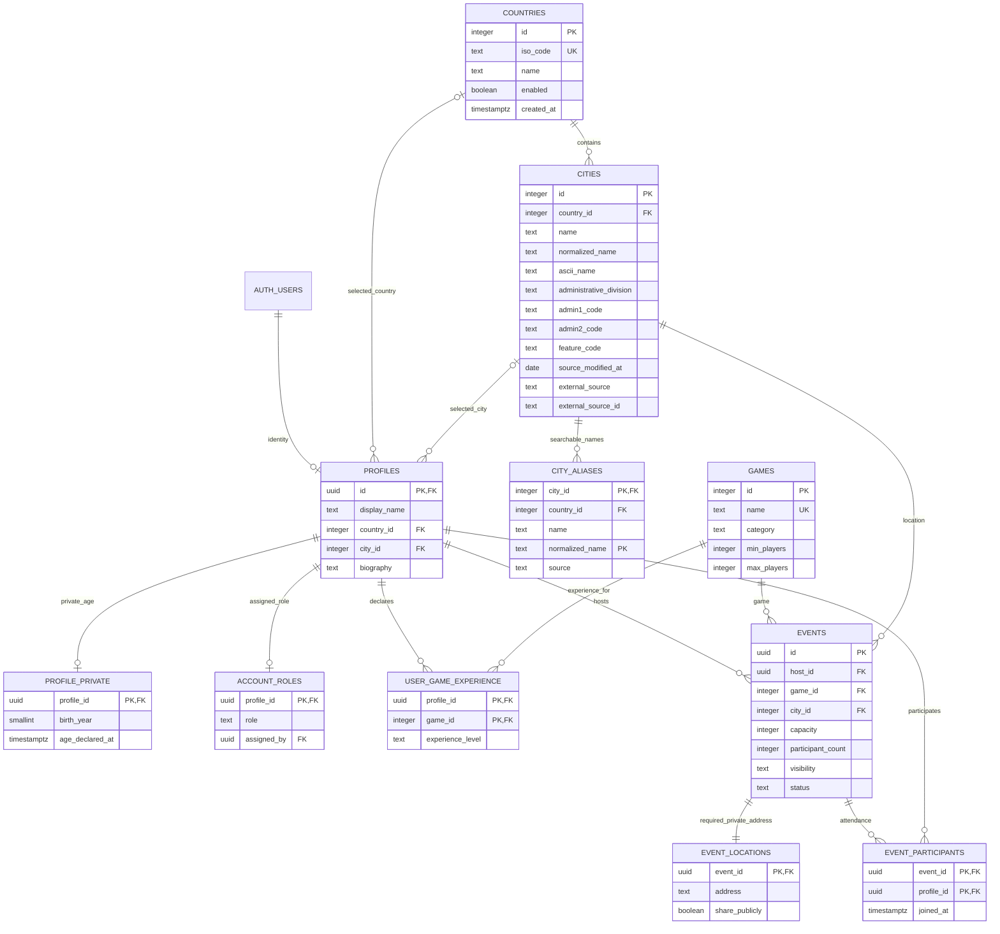

# RollCall database schema

## Scope and reproducibility

Supabase PostgreSQL 17 is configured locally in `supabase/config.toml`. Versioned SQL
creates the application schema and the four-country catalog. Milestone 2A adds alias/search
and source metadata in `20261024000300_balkan_geography.sql`. `supabase/seed.sql` still adds
only a small development place/game dataset; geographic imports are explicit maintenance
commands. There are no Auth users, profiles or events
in the development seed; frontend demo users are not migrated into real accounts.

This document describes schema foundations, not implemented event/profile HTTP routes.
Only enabled geography has client grants in Milestones 1/2A. All other application tables
have RLS enabled and no client grants/policies, so their current access is deny by default.
The `private` schema is not exposed by the local Data API.

## Relationships

The diagram abbreviates columns; the following tables and migrations define their full
constraints. `PROFILE_PRIVATE`, `ACCOUNT_ROLES`, and `EVENT_LOCATIONS` are in `private`.
The other application tables are in `public`. `AUTH_USERS` is managed by Supabase Auth.

## Geography

`public.countries`: integer identity PK; unique uppercase two-letter `iso_code`;
trimmed `name` of 2–100 characters; `enabled` defaults true; `created_at` defaults now.
The migration inserts ME/Montenegro, RS/Serbia, BA/Bosnia and Herzegovina, HR/Croatia.
There is no country CHECK limited to these four: future support is catalog data.

`public.cities`: integer identity PK and required country FK; trimmed name of 1–200
characters; required `normalized_name` maintained by a trigger using
`public.normalize_place_name`. Optional `administrative_division` is 1–200 characters. Optional
latitude/longitude use six decimal places, ranges −90..90 and −180..180 and must be
provided together. Optional population is a nonnegative bigint. Optional `external_source`
(1–50) and `external_source_id` (1–100) must be provided together. Creation time defaults
now. A partial unique source/ID index preserves stable external identity across imports.
Milestone 2A adds nullable `ascii_name` (1–200), `admin1_code` (1–20), `admin2_code` (1–80),
`feature_code` (1–10) and `source_modified_at` (date). Administrative codes are source
identifiers, not globally unique region IDs; interpret them within country/admin hierarchy.

City names are deliberately not unique: separate settlements may share a name. The
`(id, country_id)` unique key supports a composite profile FK, preventing a selected city
from belonging to another selected country. A country/name `text_pattern_ops` index
supports normalized prefix search; another country/population/normalized-name/ID index
supports suggestions. Milestone 2A adds canonical-name and alias-name GIN `pg_trgm`
indexes for substring matching. Actual query-plan/timing evidence must come from the loaded
dataset; index definitions alone are not proof of production performance.

`public.city_aliases`: city ID, matching country ID, trimmed source name (1–200), normalized
name (1–400) and source label (1–50, default `geonames`). Its primary key is
`(city_id, normalized_name)`; multiple place IDs may share a name. The composite foreign key
`(city_id, country_id)` references `cities(id, country_id)` and cascades on city deletion.
A trigger maintains normalization. Country/name-prefix and GIN trigram indexes support
search without downloading aliases to the client.

`public.normalize_place_name(text)` is STABLE, STRICT and security invoker with an empty
search path. It trims/lowercases, applies explicit common Serbian Cyrillic and `Đ`/`Dj`
transliteration, and calls schema-qualified `unaccent`. It is not declared immutable because
the extension's dictionary can change. Triggers persist the result in indexed columns;
changing normalization rules/dictionaries requires a deliberate backfill and plan review.

`public.search_cities(country_code text, search_query text default '', result_limit integer
default 4)` is stable and **security invoker**, with an empty search path and schema-qualified
relations/functions. It validates an uppercase two-letter country, query ≤80 characters
without controls, and limit 1–20. It normalizes the query, escapes SQL wildcard characters,
filters enabled ME/RS/BA/HR countries and searches canonical/alias normalized names. Exact
matches rank first, prefixes second and substrings third. Substrings require at least three
normalized characters to avoid broad short-query scans. Ties use population descending/null
last, normalized name and ID; empty queries use only this prominence order. City IDs are
deduplicated across aliases. Wildcards are literal, and static parameter-bound execution
allows a query-specific prefix plan without interpolating user text.

The RPC retains its original fields and adds country ISO/name plus admin1/admin2 codes.
Fastify explicitly maps a smaller camelCase DTO. Search is not typo correction, general
multilingual transliteration, or a guarantee that every source name variant is current.

## Profiles, roles and game experience

| Table                         | Fields and constraints                                                                                                                                                                      |
| ----------------------------- | ------------------------------------------------------------------------------------------------------------------------------------------------------------------------------------------- |
| `public.profiles`             | UUID `id` PK/FK to `auth.users.id`; trimmed display name 2–80; optional country/city (city requires country and matching composite FK); optional biography ≤500; created/updated timestamps |
| `private.profile_private`     | Profile UUID PK/FK; optional self-declared birth year ≥1900 and not in the future; birth year and declaration timestamp must both be null or both present; updated timestamp                |
| `private.account_roles`       | Profile UUID PK/FK; `user`, `admin`, or `superadmin` role (default `user`); optional `assigned_by` profile reference; created/updated timestamps                                            |
| `public.games`                | Integer identity PK; unique trimmed name 2–100; category in existing four frontend categories; description 10–1000; integer min players ≥1 and max ≥min; created/updated timestamps         |
| `public.user_game_experience` | Composite PK `(profile_id, game_id)`; profile UUID/game integer FKs; experience `beginner`, `intermediate`, or `veteran`; created/updated timestamps                                        |

Missing role assignment means an ordinary user in the planned authorization model; no
role lookup/management endpoint is implemented. Client metadata cannot assign roles.
Only a later authorized superadmin workflow may promote/demote admins. Initial superadmin
bootstrap and auditing require a controlled server/operations procedure, not a public seed.

Private birth year provides approximate self-declared age guidance without collecting a
birth date. It is neither verification nor an automatic public profile field. Per-game
experience is independently self-declared and is not a verified qualification. Public
profile DTOs and experience visibility must be explicitly designed when endpoints arrive.

Profile country/city selections can initially be unset; an onboarding flow can add stronger
completion rules later. No Auth trigger automatically creates a profile in Milestone 1.

## Events and protected locations

`public.events` contains:

| Field                           | Constraint                                                                                                                                |
| ------------------------------- | ----------------------------------------------------------------------------------------------------------------------------------------- |
| `id`                            | UUID PK, generated by PostgreSQL                                                                                                          |
| `host_id`, `game_id`, `city_id` | Required existing profile/game/city references; country derives from city                                                                 |
| `title`, `description`          | Trimmed title 3–100; trimmed description 10–5000                                                                                          |
| `venue`                         | Nullable; when supplied, trimmed 2–120 characters                                                                                         |
| `starts_at`, `ends_at`          | Required finite timestamptz values; end strictly after start; new/editable events must start in the future                                |
| `capacity`                      | Integer 1–100; host is excluded                                                                                                           |
| `participant_count`             | Integer default 0; always 0..capacity; maintained by membership triggers, never a future client-editable field                            |
| `experience_level`              | `all-levels`, `beginner`, or `experienced`                                                                                                |
| `price`, `currency`             | Nonnegative numeric ≤10000, at most two decimals; currency fixed to EUR; invalid extra precision is rejected rather than silently rounded |
| `cover_storage_path`            | Nullable future Supabase Storage object path, 1–500 characters when set; no data URLs or signed URLs should be stored here                |
| `tags`                          | Required text array, default empty; 0–6 unique canonical values and compatibility checks below                                            |
| `minimum_age`                   | Integer 0–99; 0 means all ages; informational guidance                                                                                    |
| `visibility`                    | `public`, `private`, or `unlisted`, default public                                                                                        |
| `status`                        | `scheduled` or `cancelled`, default scheduled                                                                                             |
| `created_at`, `updated_at`      | Required timestamps with now defaults; updates touch updated time                                                                         |

Event ID, host and creation time are immutable after insert. A new event cannot carry a
nonzero participant counter. A write trigger enforces future starts on new or materially
edited records; internal attendance counter/timestamp updates do not revalidate old start
times. Database ownership is not API authorization: later create/edit routes still need
verified actors, ownership checks and strict allowlisted payloads.

Canonical tags mirror the frontend: Beginner friendly, Veterans only, Casual, Competitive,
One-shot, Campaign, Bring your own deck, Equipment provided. Tags cannot contain nulls,
duplicates or arbitrary values. Beginner friendly and Veterans only are incompatible;
the former requires all-levels/beginner and the latter experienced. These checks apply
to the final merged database row.

`private.event_locations` has an event UUID PK/FK, required trimmed address of 3–200
characters, `share_publicly` default false, and updated timestamp. Deferred constraint
triggers require an address record for each in-person event by transaction end, so a
future create transaction can insert event and protected location together. Exact addresses
are never columns on public event records. The opt-in flag itself grants no access and
must never expose a private event before authorization.

Host/game/city FK indexes and a partial scheduled-public `(starts_at, id)` index support
future event ownership and discovery reads. No discovery/event HTTP query is implemented
against these tables yet.

## Attendance and transactional capacity

`public.event_participants` has event UUID/profile UUID FKs, a composite primary key
preventing duplicate membership, and `joined_at`. Membership rows are immutable; future
join/leave operations insert/delete instead of rewriting identities. A profile-side index
supports membership lookup.

An AFTER INSERT trigger atomically increments `events.participant_count` only when the
event is scheduled, future, non-host and below capacity. Competing final-seat inserts
serialize on that parent row; a failed increment raises an error and rolls the inserted
membership back. Running after insert preserves `ON CONFLICT DO NOTHING` semantics for
duplicate members. The count/capacity CHECK also prevents an edit below current attendance.
Deletion decrements the counter only for an available event; event deletion's cascading
membership cleanup is exempt. Future API transactions must still enforce private-event
authorization and actor identity before performing writes. No client can currently edit
the counter, insert membership or call an event mutation through the Data API.

This is database integrity groundwork, not a completed join API. Concurrent multi-connection
integration tests must remain part of delivering real attendance endpoints.

## Delete behavior and timestamps

- Country deletion is restricted by cities/profiles. City deletion is restricted by profiles/events.
- Auth-user deletion cascades toward its profile. Profile private details, role assignments and
  per-game experience cascade with profile deletion; `assigned_by` becomes null if its referenced
  profile is deleted. Existing host/participant references restrict profile deletion, so real
  account deletion needs an explicit future event/attendance retention workflow.
- Game deletion is restricted by events and user-game experience.
- Event deletion cascades to attendance and the private address. A deferred address check
  permits whole-event deletion while preventing an orphaned location-less live event.
- Profiles, private age/roles, games, experience, events and private locations have update
  triggers for `updated_at`. Immutable membership has `joined_at`; geography has creation time.

## RLS and grants

All application tables, including those in `private` and the new city alias table, have RLS enabled. Migrations
revoke implicit client grants on application tables/sequences/functions and PostgreSQL
default function execution, then grant only geography SELECT and search execution to
`anon` and `authenticated`. Countries expose enabled rows; city SELECT requires an enabled
parent country. Aliases require an enabled matching country as well. Search is security
invoker so direct calls retain these restrictions. Direct table reads remain catalog reads;
the bounded RPC additionally restricts searches to the four supported countries.

No application table has INSERT/UPDATE/DELETE grants to those roles. No non-geography
SELECT grant/policy exists yet. The `private` schema has no client usage grants and is not
in the API's exposed schemas. No application service-role grants are provided or needed.
The database owner remains an administrative trust boundary and must not become the
ordinary request identity.

Trigger/helpers use schema-qualified objects and hardened empty search paths. There is
no security-definer event/role shortcut or general-purpose privileged RPC. Later grants,
RLS and any narrowly scoped trusted functions must ship with actor-specific tests.

Invitation secrets have no table/column in Milestone 1. A later dedicated, non-exposed
table must support verification hashes, authenticated encrypted retrieval, rotation and
revocation. Ordinary participants never receive the code. See
[the authorization design](backend-architecture.md) for planned workflows.

## Development seed and geographic import

The seed contains 13 real place names: ME Podgorica/Nikšić/Budva/Bar; RS Beograd/Novi Sad/
Čačak; BA Sarajevo/Banja Luka/Mostar; HR Zagreb/Split/Rijeka. It is a manually curated,
incomplete development sample. Optional coordinates, divisions, population and source IDs
are left null rather than fabricated. Eight games mirror the existing frontend catalog
for convenient development; matching seed numbers are not an identity-migration strategy.

Milestone 2A's explicit importer reads the four GeoNames country extracts, selecting eligible
populated places without a population minimum. SHA-256 inputs and per-country reports record
provenance and outcomes. The `(external_source, external_source_id)` identity supports reruns
without changing internal IDs. Only unambiguous recognized development seeds are adopted;
manual/ambiguous records are preserved. Administrative labels are resolved from ADM1/ADM2
records in the same country files. Imported aliases remain source-labeled and additive.

Import metadata is source-owned; no city is removed because it is absent from a newer
extract. This prevents destructive updates to referenced application locations but means
source deletions/renames and alias retirement need an explicit reviewed reconciliation policy.
See [geographic import](geographic-import.md) for exact inclusion codes, CC BY 4.0 attribution,
commands, counts and limitations. Neither the sample seed nor the broader import is a claim
of perfect geographic completeness.

## Local verification

From the root, `pnpm db:start` initializes the local stack. `pnpm db:reset` destroys and
rebuilds only the local database; inspect/preserve existing data before any reset. Use
`pnpm exec supabase db push --local` to apply pending migrations without resetting data.
`pnpm db:lint` performs local SQL analysis and
`pnpm db:test` runs the committed SQL assertions. `pnpm db:test:concurrency` uses separate
local PostgreSQL transactions to verify final-seat and capacity races. Run `pnpm test:integration` with the
explicit local opt-in described in [backend setup](../backend/README.md) to exercise the
HTTP/database boundary. SQL files being present does not mean these commands succeeded;
the delivery report must state the actual execution results and any unavailable checks.

Official references: [PostgreSQL transaction isolation](https://www.postgresql.org/docs/current/transaction-iso.html),
[Supabase database functions](https://supabase.com/docs/guides/database/functions),
[Supabase API security](https://supabase.com/docs/guides/api/securing-your-api),
[Supabase local configuration](https://supabase.com/docs/guides/local-development/cli/config),
and [GeoNames export/license](https://www.geonames.org/export/).
