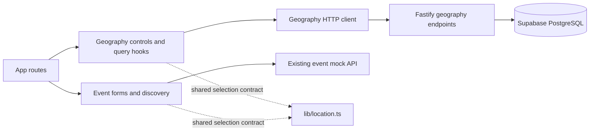

# Frontend country and city integration

Milestone 2B connected React to the existing geography API. Milestone 3A now provides real
Supabase Auth separately; events, user/game catalogs, attendance and the explicitly enabled
development demo session retain their frontend mocks. Creating or editing
an event does not write PostgreSQL, create a real account or persist across page reloads.
This milestone preserves the RollCall layout, branding and dark/light token palettes.

## Data flow and ownership



`frontend/src/features/geography/` owns API response types, HTTP data access, TanStack Query
hooks, its HTTP client and reusable country/city controls. It calls only:

- `GET /api/countries`: enabled `{ id, isoCode, name }` rows.
- `GET /api/cities?country=ME&q=...&limit=4`: bounded, ranked city suggestions.

City responses include integer `id`/`countryId`, canonical `name`, country ISO/name,
administrative label/codes and nullable coordinates. Features do not import one another.
App routes pass geography controls into event render slots; the shared selection contract
contains no fetching, fixture records or dependencies on feature internals.

Geographic IDs are PostgreSQL integers, not UUIDs or frontend event IDs. The existing event
and demo user IDs stay numeric. Real Supabase profile/event UUID integration belongs to a
later milestone and must use explicit adapters rather than numeric coercion.

## Selection reference and legacy compatibility

`frontend/src/lib/location.ts` defines `LocationReference` and its validation schema:

```ts
type LocationReference = {
  cityId: number
  countryId: number
  countryIsoCode: string
  countryName: string
  cityName: string
  administrativeDivision: string | null
  admin1Code: string | null
  admin2Code: string | null
}
```

IDs are actual positive backend integers, bounded by PostgreSQL integer range. Names and
region values are a display snapshot, not an extra country/city catalog. Selecting a
suggestion stores this reference plus the mock event's existing human-readable `city`
and matching `countryCode`. Components never invent an ID based on a city name.

Existing fixtures retain their original city labels and explicit ME country. They do not
gain guessed database IDs. A legacy event editor shows its previous city text as guidance
but requires an actual suggestion before saving. Previously selected reference-backed
events retain their selected location while editing other fields.

Create/edit form validation requires a non-null location and country. Typing a familiar
city name is not selection. The mock API keeps optional location/country fields for legacy
callers, validates references when supplied and rejects mismatched location/city/country
values. It does not revalidate a geographic foreign key against the database: the real
event API must do that in a future milestone.

## Interaction and search

Country options are loaded from the API, not copied into the form. A city cannot be chosen
until a country is selected. Country loading, empty catalog, network errors and retry
controls remain visible; they never silently substitute fake geographic results.

Focusing/clicking the city input opens approximately four suggestions. Typing searches the
backend after about 250 ms. Query keys include country/query and requests consume abort
signals; previous-country and out-of-order results cannot replace the current results.
Country/city query results are fresh for five minutes; automatic retries are disabled so
failures immediately expose explicit retry controls. HTTP requests have a five-second bound.
Changing country clears selection, typed city and old suggestions immediately. Editing
city text also clears the confirmed selection.

The input uses an editable combobox/listbox pattern with a labeled input, expanded state,
active descendant and selected option. ArrowUp/ArrowDown moves the active option; Enter
selects; Escape closes without submitting the surrounding form. Focus remains on the input.
Results show region context so same-name settlements can be distinguished. Loading, no
matches and errors have useful text; failed requests provide retry actions. Controls fit
375px layouts and use the existing semantic tokens in both themes.

Search semantics remain in the backend: accents, aliases and common Serbian Cyrillic/Latin
forms are supported where source data permits. Examples include `Cacak`/`Čačak` and
`Niksic`/`Nikšić`. Exact matches precede prefixes, then substrings for at least three
normalized characters; one/two-character searches use prefixes only. Empty input favors
populous places. The UI requests four results, not the entire dataset.

Geographic data is supplied by [GeoNames](https://www.geonames.org/) under
[CC BY 4.0](https://creativecommons.org/licenses/by/4.0/), filtered/normalized for RollCall.
The control displays attribution; source limitations and preserved ambiguous seed rows are
documented in [geographic import](geographic-import.md).

## Discovery URLs and homepage

Applied discovery filters continue using URL parameters. Selected geography uses:

```text
/events?country=ME&cityId=<actual-city-id>&city=Podgorica
```

The example is schematic; use an ID returned by the current backend, not a hardcoded
example ID. `search`, `gameId`, `category` and `availableOnly` remain compatible and combine
with geography. Country-only filtering is valid. Changing country clears the city ID and
label; Reset Filters removes both. Back/Forward restores applied URL selections.
The optional `region` URL parameter restores display context; it is not an event API filter.
Restoring a discovery filter from a URL does not count as a validated event-form selection.

Reference-backed events match a selected city by ID. For unresolved legacy ME fixtures,
the mock filter has an explicit compatibility bridge: country ME plus the selected canonical
city label is matched case/diacritic-insensitively. This is a temporary demo name bridge,
not evidence that two same-name places share an identity. Legacy city-string URLs remain
supported. No cross-country name-only matching is used for selected-ID filters.

The homepage reuses location selection consistently with discovery while keeping its hero,
game categories, featured cards and search layout. Copy describes regional discovery
without claiming foreign mock events already exist. The original fixtures remain Montenegro
events; users can create additional country events during the current page runtime.

## Optional venue and address display

Venue/meeting point is optional on both form routes and in mock create/update operations.
Omitted create values normalize to `''`; blank is accepted. A supplied value must contain
2–120 trimmed characters. Cards and details omit absent venue labels/separators. Address
is still required for an in-person event.

Exact address text renders only for the event host or a current attendee. Anonymous users
and other signed-in users see an explanation that it is shared with confirmed participants.
This applies to public/unlisted details too. Joining or leaving updates the visible state
through the existing mock mutations. Private event read rules remain host/current-attendee
only; no private invitation flow is introduced.

Mock objects and fixtures are client-side and still contain addresses. Hiding them in the
UI is not a security or privacy boundary. Real event endpoints must derive identity from
verified authentication, authorize exact-location reads, omit unauthorized addresses from
DTOs and enforce database/RLS rules. Do not ship real residential addresses in mock data.

## Local setup and configuration

Use root commands and `pnpm.cmd` on PowerShell when `.ps1` shims are blocked.

```bash
pnpm install
pnpm db:start
pnpm exec supabase db push --local
```

Configure ignored `backend/.env` using `backend/.env.example` and local Supabase status:
`SUPABASE_URL` plus an unprivileged publishable/legacy anon key. Geography alone needs no
browser Supabase key; real Auth additionally needs the public URL/key in `frontend/.env`,
as described in [authentication setup](authentication.md). If populated-place coverage is absent,
follow [the importer](geographic-import.md);
do not reset an existing populated database merely to start the UI.

In one terminal:

```bash
pnpm dev:backend
```

In a second terminal:

```bash
pnpm dev
```

Fastify defaults to `http://127.0.0.1:3001`; Vite defaults to `http://localhost:5173`.
Vite dev and preview proxy `/api` to `API_PROXY_TARGET`, defaulting to the local Fastify
origin. `API_PROXY_TARGET` is read by Vite configuration, not exposed as a browser secret.
Optional browser `VITE_API_ORIGIN` overrides the HTTP origin; its default is empty for
same-origin `/api` requests. See `frontend/.env.example`. Never put database passwords,
Supabase secrets or service-role keys in `VITE_*` variables.

The local proxy avoids browser cross-origin requests. A deployed frontend should route
`/api` to Fastify on the same origin, or deliberately configure and review an API origin
and allowed-origin CORS policy. Deployment/CORS policy changes are not implied by setting
a frontend variable. No production URL is hardcoded.

The frontend can build without Fastify or Supabase running. Mock events remain browseable;
country/city operations show network errors/retry and forms cannot submit an unconfirmed
location. This is intentional failure behavior, not offline geographic data support.

## Verification and next milestone

Repeatable checks from the root:

```bash
pnpm test:geography
pnpm test:mock
# With local Supabase, Fastify and Vite running:
pnpm test:ui
```

Browser tests use Playwright with installed Google Chrome by default and run 375px/1440px
in both themes. `PLAYWRIGHT_BASE_URL` can change the Vite origin; `PLAYWRIGHT_CHANNEL` can
select another installed Playwright browser channel. Browser binaries are not downloaded
automatically. For CI without Chrome, install the intended Playwright browser explicitly.
Screenshots/traces go to ignored `frontend/test-results/`. Tests use fresh browser contexts;
multi-event journeys stay within one page runtime because reloading resets event mocks.

Executed results are recorded in [location UI verification](location-ui-verification.md).

Run frontend/backend typecheck, lint and build, existing mock tests, backend geography
tests and relevant live integration tests. UI verification must cover all four country
selections, typed/keyboard selection, empty/error/retry/stale responses, optional venue,
legacy editing, discovery URL navigation, join/leave and both themes at 375px/1440px.
Record results actually executed in the milestone handoff; preparing these controls is
not proof that a browser or live database check passed.

Milestone 3 should introduce real Supabase identity/profile onboarding with server-enforced
authorization and deliberate UUID adapters. Persistent event APIs remain separate work.
Neither this milestone nor its location snapshot creates real accounts or durable events.
